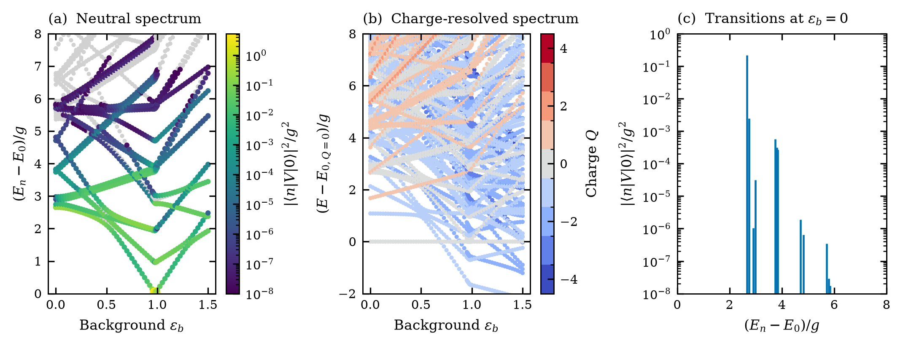
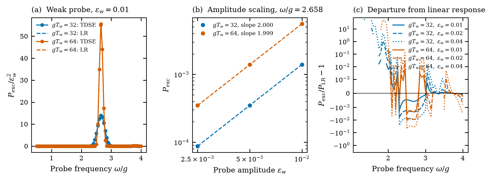
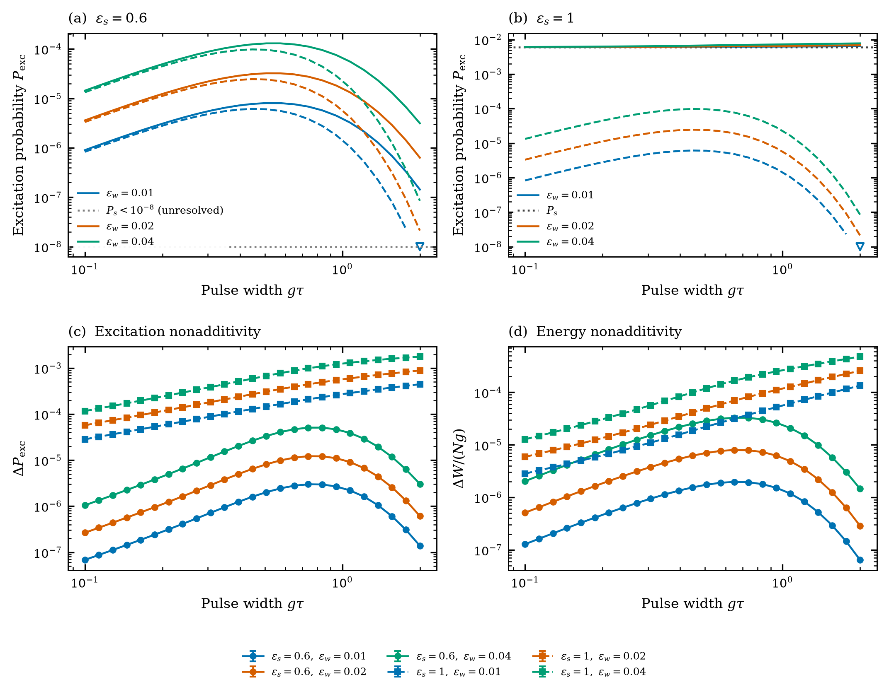
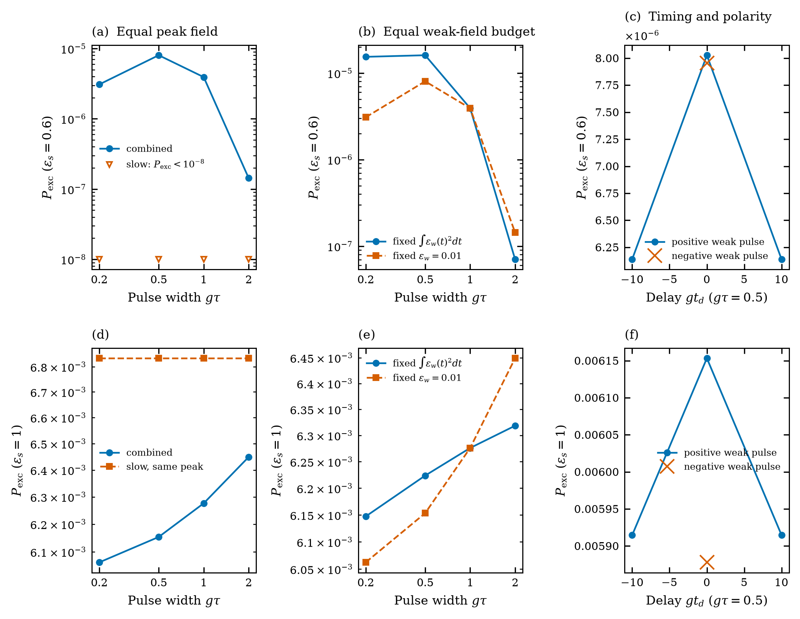
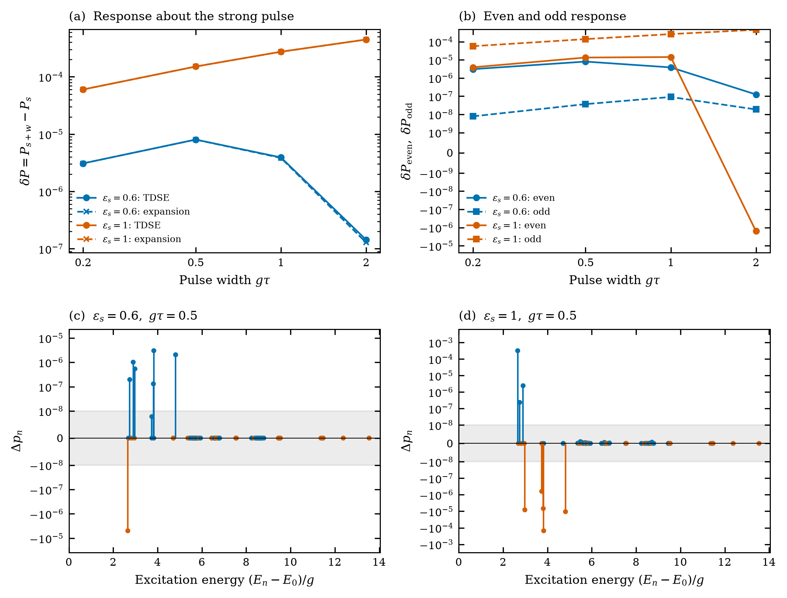
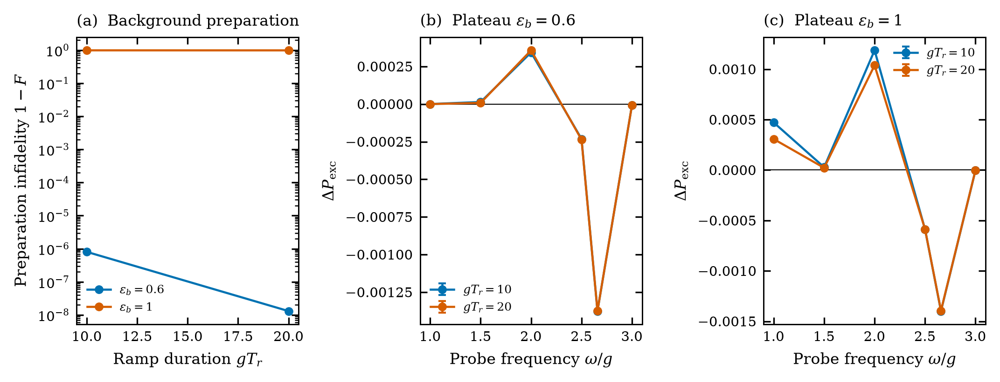
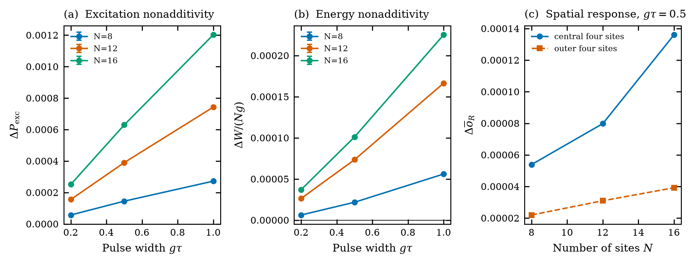
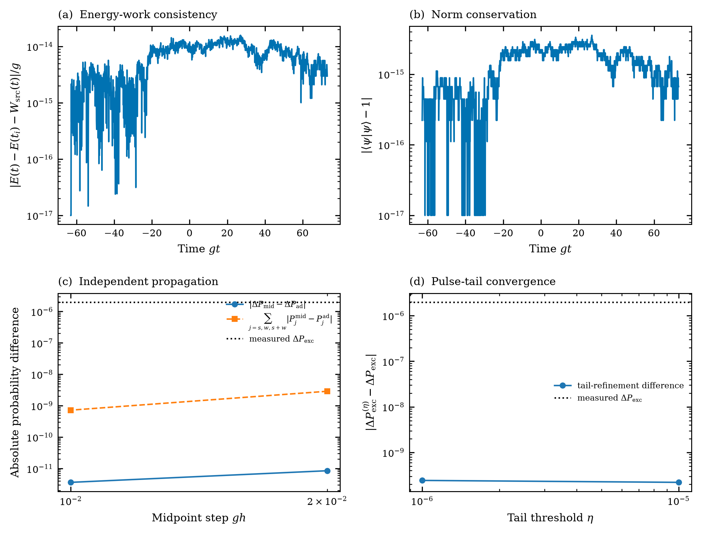

# Understanding the driven experiments and their eight figures

The central result is that a strong electric pulse changes how the finite
lattice responds to an additional weak pulse. In the main scan the combined
excitation exceeds the sum of the separate excitations. The controls show
that this statement has different physical meanings in the two tested
backgrounds. The plateau experiment also shows that adding a probe can
suppress excitation relative to that sum.

This document starts from the baseline reproduction and explains what each
experiment adds. It describes the measured results; it does not assume a
continuum pair-production interpretation.

## From the baseline to the new question

In the baseline you prepared the zero-field vacuum and studied the lattice
Hamiltonian and its evolution. Here the field changes during the evolution:

\[
H(t)=H_0+\epsilon(t)V+c\epsilon(t)^2I.
\]

Think of the field as the external input and the lattice as the system being
excited. We ask whether a weak input has a different effect when a strong
input is also present. Evolving with the actual changing Hamiltonian matters:
using one final field value for the whole experiment would describe a
different experiment.

All driven trajectories start in the **exact neutral zero-field ground
state**, and the implemented pulses return to zero. The open lattice has
$m/g=ag=1$. Most results use $N=8$; Figure 7 also uses $N=12,16$. Charge is
fixed to $Q=0$ in the dynamics. Static spectra include other charge sectors
only to explain which levels are inaccessible to these dynamics.

The baseline code, data and plots remain separate and unchanged. New figures
are explicitly identified as the **driven study** by their directory,
[figure index](figures.md), metadata and captions.

## The quantities you will see

The initial vacuum is $|0\rangle$ and the final state is $|\psi_f\rangle$.

| Symbol in the figures | Plain meaning | Definition |
| --- | --- | --- |
| $P_{\mathrm{exc}}$ | Probability of ending outside the initial vacuum | $1-|\langle0|\psi_f\rangle|^2$ |
| $W$ | Energy left in the lattice after the field is off | $\langle\psi_f|H_0|\psi_f\rangle-E_0$ |
| $\Delta P_{\mathrm{exc}}$ | Combined excitation minus the sum of separate excitations | $P_{s+w}-P_s-P_w$ |
| $\Delta W$ | The same comparison for absorbed energy | $W_{s+w}-W_s-W_w$ |

Subscripts $s,w,s+w$ mean strong only, weak only and both pulses. Every one
of these trajectories starts from the same vacuum. These are separate runs,
not successive probability measurements on one state.

A positive $\Delta P_{\mathrm{exc}}$ says that the combined response is
larger than this additive comparison. It does **not** by itself establish
that fast pulses outperform slow pulses, that real particles were counted,
or that tunnelling caused the effect. Those require additional comparisons.
Probabilities in a coherently driven quantum system need not add.

The saved code calls these quantities `Y`, `W`, `D_Y`, and `D_W`.
The plots use $P_{\mathrm{exc}}$ to make the first quantity's meaning explicit.
A value $P_{\mathrm{exc}}=10^{-5}$ is about ten excited outcomes per million
ideal repetitions. It is not ten produced pairs per million repetitions.

Time and energy axes are dimensionless: $g\tau$ is pulse width,
$\omega/g$ is angular frequency and $\Delta W/(Ng)$ is energy nonadditivity
per site. The field parameter $\epsilon$ is dimensionless.

The probability resolution floor is $10^{-8}$. Values below it are kept in
raw data but are not treated as resolved effects. Numerical error bars show
changes under solver refinements, sometimes supplemented by tail or
independent-method comparisons. They are **not statistical confidence
intervals or rigorous upper bounds**. Where no such estimate was calculated,
the plots do not invent an error bar.

## 1. Which excited states can the field reach?

**Why run this experiment?** Before applying pulses, we need to know what
energy differences the field can excite. Otherwise a low-energy state could
be mistaken for a resonance even when the drive cannot reach it.

**What was done?** The Hamiltonian was diagonalized at 79 static background
values. Within the neutral sector we calculated both the energy gaps and the
field-coupling weights $|\langle n|V|0\rangle|^2$. Larger weights mean a
stronger leading-order response to a weak field with the right frequency.

**Read the panels from left to right.**

- **(a) Neutral spectrum:** height is excitation energy. Gray points show the
  levels; colored points show transitions above the stated weight threshold.
  Their color and size encode coupling strength on common scales.
- **(b) Charge-resolved spectrum:** levels from all charge sectors, colored by
  charge. Energies are measured relative to the neutral ground state at the
  same background. A negative value here means another sector lies lower;
  it does not mean a negative neutral excitation energy.
- **(c) Zero-background transitions:** each stick marks an energy difference
  and its coupling weight. The vertical scale is logarithmic so weak allowed
  transitions remain visible beside the dominant one.

At zero background the first neutral excitation costs approximately
$2.657994g$, and its drive weight is approximately $0.216568g^2$.
Thus **2.658 is an energy difference**, and $2.658g$ is also the corresponding
angular frequency when $\hbar=1$. It is not the absolute energy of a state.

The lowest gap in the unrestricted Hilbert space is approximately
$1.082913g$, to a charged state. The neutral drive cannot change total charge.
That lower state is therefore not an available transition from the neutral
vacuum. Similarly, the charged-sector crossing near $\epsilon_b=0.692376$
is not a dynamical excitation route for this protocol.

**Conclusion:** the relevant zero-field resonance is determined by neutral
energy gaps **and** coupling weights. The smallest unrestricted gap alone is
not sufficient. The figure displays energies only up to the stated limits;
it does not claim that higher states do not exist.

## 2. Does a weak probe behave as expected?

**Why run this experiment?** We want a checkable reference before interpreting
a more complicated two-pulse result.

**What was done?** A weak sinusoidal field, smoothly switched on and off, was
applied to the zero-field vacuum. Its frequency, amplitude and duration were
varied. The measured response was compared with a calculation using the
neutral gaps, coupling weights and Fourier transform of the actual pulse.

- **(a) Frequency response:** the strongest excitation occurs near
  $\omega/g=2.658$. Solid curves with markers are numerical propagation;
  dashed curves are the leading weak-field prediction. The longer probe
  resolves a narrower frequency range and gives a higher resonant response.
- **(b) Amplitude scaling:** near that resonance, doubling a sufficiently
  small amplitude multiplies excitation by approximately four. The fitted
  log-log slopes are about 2.000 and 1.999. Dashed lines are quadratic guides,
  not additional experiments.
- **(c) Approximation limits:** zero means agreement with the leading
  prediction. Some frequencies and larger amplitudes depart substantially.
  Gaps in the curves mean that the measured or predicted probability was
  below $10^{-8}$; a ratio there would be misleading.

**Conclusion:** the weak-field calculation correctly predicts the accessible
resonance and small-amplitude quadratic scaling. It is a useful reference,
but it does not explain every point of the entire scan at every amplitude.
The discrete frequency grid does not determine a precisely fitted linewidth.

## 3. What changes when the pulses are combined?

**Why run this experiment?** This is the main question: does a weak, short
pulse produce a different response in the presence of a strong, broad pulse?

**What was done?** Two smoothly truncated Sauter pulses were centered at the
same time. The strong width was $gT_s=10$. The weak width covered
$0.1\le g\tau\le2$; weak amplitudes were 0.01, 0.02 and 0.04. Two strong
amplitudes, 0.6 and 1, were selected by the retained strong-only calibration.
Together these give 150 main-scan points.

The calibration matters: amplitude 0.6 produces an unresolved strong-only
excitation, whereas amplitude 1 already produces $P_s\approx0.006002$.
These two backgrounds are not physically interchangeable.

- **(a,b) Absolute probabilities:** solid curves are both pulses, dashed
  curves are the weak pulse alone. The dotted reference is strong-only.
  A downward open triangle or a floor reference identifies an unresolved
  probability rather than presenting its raw small value as resolved.
- **(c) Excitation difference:** $\Delta P_{\mathrm{exc}}>0$ means both pulses
  exceed the sum of their separate excitation probabilities.
- **(d) Energy difference:** $\Delta W/(Ng)$ asks whether the same comparison
  also leaves additional energy per site.

For a concrete example, take $\epsilon_s=0.6$, $\epsilon_w=0.01$ and
$g\tau=0.5$ from the dedicated control run:

| Run | Excitation probability |
| --- | --- |
| Strong only | Below $10^{-8}$ |
| Weak only | $6.056\times10^{-6}$ |
| Both | $8.027\times10^{-6}$ |
| Combined minus separate sum | $1.972\times10^{-6}$ |

This is about eight excited outcomes per million instead of six. The excess
is roughly 32.6% of the weak-only response, but its absolute size remains
about two per million. We emphasize the absolute values rather than a ratio
with a potentially unresolved denominator.

**Conclusion:** positive excitation and energy nonadditivity occur across
this measured main grid. The next question is what that difference means;
positive nonadditivity alone does not identify its mechanism or establish
that a fast input is the best input.

## 4. Could simpler changes explain the difference?

**Why run this experiment?** Adding a pulse changes several things at once:
the peak field, its time profile, the input budget, and quantum phases. We
need controls before attributing the result specifically to fast assistance.

**What was done?** At weak amplitude 0.01, the combined pulse was compared
with a slow pulse of the same peak, a family with the same integrated weak
field squared, delayed weak pulses, and an opposite-polarity weak pulse.
The upper row uses $\epsilon_s=0.6$; the lower uses $\epsilon_s=1$.

- **(a,d) Same peak:** for background 0.6 the slow equal-peak pulse remains
  unresolved while the combined pulse is resolved. Peak height alone does
  not account for this result. For background 1, the slow equal-peak pulse
  actually produces more excitation than the combined pulse.
- **(b,e) Same weak-field budget:** changing the width while holding
  $\int\epsilon_w(t)^2dt$ fixed changes the curve. The comparison with fixed
  peak amplitude shows why width changes cannot be interpreted without
  saying what input quantity is held fixed. This integral is an input
  convention; it is not the energy absorbed by the lattice.
- **(c,f) Timing and polarity:** at $g\tau=0.5$, shifting the weak pulse away
  from the strong peak reduces the combined response. Reversing its sign
  changes the response little for background 0.6 but strongly for background
  1; in the latter case it can reduce excitation below strong-only.

**Conclusion:** for the selected background-0.6 point, a trivial peak-height
increase is insufficient. Background 1 exhibits a much stronger sensitivity
to polarity, consistent with coherent interference. There is no universal
claim that the combined fast pulse beats a slow pulse of the same peak.
These controls isolate particular alternatives; they do not hold every
possible resource measure fixed at once.

## 5. How does the strong pulse change the response, and where does the excess go?

**Why run this experiment?** A total probability says how much excitation
occurred. It does not say how the strong pulse changed the weak response or
which final energy levels gained and lost population.

**What was done?** We calculated a response expansion around the actual
strong-pulse trajectory, rather than around the undriven vacuum. We also
reversed the weak pulse and resolved the final state into all 69 neutral
excited states of the zero-field $N=8$ Hamiltonian.

- **(a) Strong-pulse response prediction:** the added excitation
  $\delta P=P_{s+w}-P_s$ is compared with the expansion through second order
  in weak amplitude. At the representative background-0.6, width-0.5 point,
  the prediction for total excitation is $8.005\times10^{-6}$ versus the
  measured $8.027\times10^{-6}$. Agreement deteriorates at width 2 in that
  background, so the approximation is not uniformly accurate.
- **(b) Even and odd response:** the part that is unchanged when the weak
  field is reversed is separated from the part that changes sign. The even
  part dominates for background 0.6. The odd part dominates for background
  1. A leading odd term arises from interference with the excitation already
  generated by the strong pulse; the sign test demonstrates this sensitivity
  without assigning a unique microscopic path.
- **(c,d) Final-state contributions:** at $g\tau=0.5$, every excited state's
  contribution is $\Delta p_n=p_n^{s+w}-p_n^s-p_n^w$. The horizontal axis is
  its excitation energy. Blue stems are positive and orange stems negative.
  Their signed sum equals $\Delta P_{\mathrm{exc}}$. The gray band marks a
  $10^{-8}$ reference scale, not a confidence interval for each population.

For background 0.6, the first excited state contributes approximately
$-4.962\times10^{-6}$, while states 12 and 15 contribute
$+3.001\times10^{-6}$ and $+2.047\times10^{-6}$. Their gaps are about
$2.658g$, $3.831g$ and $4.815g$. Thus the net increase is **not simply more
population in the first excited state**: higher levels gain while that first
level loses relative to the separate-pulse comparison. Other levels also
contribute and all are included.

For background 1, the first state instead contributes positively, about
$3.200\times10^{-4}$; state 12 contributes negatively, about
$-1.515\times10^{-4}$. This is a different redistribution pattern.

**Conclusion:** the strong pulse changes the weak response, and the two
backgrounds have different sign sensitivity and final-state redistribution.
The calculation provides a response-level explanation. Final populations
do not reconstruct a unique sequence of transitions during the pulse.

## 6. Can a prepared background help or hinder the probe?

**Why run this experiment?** Static spectra suggest that a background changes
excitation energies. But a laboratory-style ramp does not automatically
prepare the ground state of that background.

**What was done?** Starting at zero field, the field was ramped to a plateau,
a weak sine probe was applied, and the field was ramped back to zero.
Two ramp durations and six probe frequencies were tested. The state just
after ramp-up was compared with the lowest neutral state at that background.

- **(a) Preparation infidelity:** a small $1-F$ means the ramped state is
  close to the intended neutral ground state. At background 0.6, $F$ is
  about 0.9999992 and 0.99999999 for the two ramps. At background 1 it is
  only about 0.0116 and 0.0138: roughly 1–1.4% overlap probability.
- **(b,c) Probe response:** positive and negative
  $\Delta P_{\mathrm{exc}}$ both occur, depending on frequency. The probe can
  increase or suppress excitation relative to the separate-run sum.

**Conclusion:** a background does not always enhance the response. Also,
static ground-state gaps cannot quantitatively describe a probe acting on a
poorly prepared, nonstationary state. These are six sampled frequencies,
not a resolved frequency map or a precise measurement of peak locations.
The plateau and the Sauter pulse are different protocols; their responses
must not be silently equated.

## 7. Does the selected effect survive a larger lattice?

**Why run this experiment?** A result on eight sites might disappear with
size or arise entirely near open boundaries.

**What was done?** The same background-1 protocol, weak amplitude 0.01 and
three weak widths were repeated at $N=8,12,16$. Lattice spacing, couplings,
pulse parameters and the post-pulse averaging duration were held fixed.

- **(a) Excitation difference:** it remains positive at all nine points.
  At $g\tau=0.5$ it is approximately $1.45\times10^{-4}$,
  $3.90\times10^{-4}$ and $6.30\times10^{-4}$ as size increases.
- **(b) Energy difference per site:** this also remains positive but changes
  with size. The available lattices have not reached a demonstrated
  size-independent limit.
- **(c) Spatial response:** local occupation is measured relative to the
  vacuum, averaged over the post-pulse interval, and combined with the same
  strong-plus-weak subtraction. The mean of the central four sites is
  compared with the mean of the two sites at each edge. Both contribute;
  the central mean is larger in these runs.

**Conclusion:** the selected positive effect persists to 16 sites, and this
local occupation diagnostic is not confined to the boundary sites. This does
not prove that boundaries are irrelevant to the overall dynamics. Increasing
$N$ at fixed spacing tests finite volume, not the continuum. The size test
was done for background 1; it does not establish the size behavior of the
background-0.6 example.

## 8. Is the representative excess larger than numerical changes?

**Why run this experiment?** The representative excess is small. We must
check that it survives changes to the numerical procedure and pulse tails.

**What was done?** For $\epsilon_s=0.6$, $\epsilon_w=0.01$, $g\tau=0.5$,
we checked energy-work consistency, norm conservation, an independent
exponential-midpoint propagator, and smaller tail truncation thresholds.

- **(a) Work consistency:** the energy change agrees with integrated work
  supplied by the field to about $10^{-14}g$ in this trajectory.
- **(b) Norm:** normalization drift is near floating-point precision.
  Exact zeros in these logarithmic diagnostics are displayed at $10^{-17}$.
  The neutral sector is enforced in the basis; its conservation is not an
  independent leakage test and is therefore not plotted as one.
- **(c) Independent propagation:** changing the method and halving its step
  changes the signed excess by around $10^{-11}$. The sum of absolute
  changes of the three constituent probabilities is larger, around
  $10^{-9}$, but remains well below the $1.97\times10^{-6}$ signal.
- **(d) Pulse tails:** extending the tails changes the excess by a few
  $10^{-10}$, again much smaller than that signal.

**Conclusion:** the tested numerical changes are too small to account for
the representative excess. This supports that particular result; it is not
a rigorous bound on all possible numerical errors or on all scan points.
The main scan also retains its own solver refinements.

## What the complete set establishes

1. **The field accesses a constrained spectrum.** Charge conservation and
   coupling weights determine which gaps are relevant; the unrestricted
   first gap is insufficient.
2. **The weak response has a validated reference regime.** The accessible
   resonance and quadratic amplitude scaling are recovered, with visible
   departures outside that regime.
3. **Combining the pulses changes the response beyond the separate-run
   sum.** The main scan shows positive excitation and energy nonadditivity.
   The plateau experiment shows that suppression can also occur.
4. **The two backgrounds exhibit different response regimes.** The selected
   0.6 example is primarily sign-even and includes redistribution into higher
   excited states. The 1 example has a large sign-odd contribution, and an
   equal-peak slow pulse can excite more than the combined pulse.
5. **The evidence has tested limits.** A selected background-1 effect persists
   through 16 sites, while the representative background-0.6 effect passes
   independent propagation and tail checks. These checks have different
   scopes and should not be merged into a claim that every feature was
   validated at every size.

A defensible final statement is:

> In the simulated finite open Schwinger lattices, a strong pulse modifies
> the neutral vacuum's response to a weak pulse. The modification depends on
> pulse timing, polarity, background preparation and final-state
> redistribution. Selected positive nonadditivity survives the numerical and
> finite-size comparisons that were performed.

The figures do not establish a continuum pair-production rate, a tunnelling
mechanism, a universal advantage of fast assistance, quantum advantage or a
hardware-ready experiment. Those stronger claims would require additional
physics definitions and experiments.

## Final conclusion

The main observation is that, in this finite open Schwinger lattice, the
response to a strong pulse and a weak pulse together differs from the sum of
their responses when applied separately. All three runs start from the same
neutral vacuum, and the comparison is

\[
\Delta P_{\mathrm{exc}}=P_{s+w}-P_s-P_w.
\]

In the 150 tested points of the two-Sauter-pulse scan, both this excitation
difference and the corresponding energy difference are positive. For example,
at $\epsilon_s=0.6$, $\epsilon_w=0.01$ and $g\tau=0.5$, the weak pulse alone
gives $P_w\approx6.056\times10^{-6}$, while the combined pulses give
$P_{s+w}\approx8.027\times10^{-6}$. The strong-only probability is below the
$10^{-8}$ reporting floor, and the difference is
$\Delta P_{\mathrm{exc}}\approx1.972\times10^{-6}$. This excess is about 33%
of the weak-only probability, but its absolute size is about two excited
outcomes per million ideal repetitions.

The controls show that the interpretation depends on the field protocol. At
the selected strong amplitude 0.6, a slow pulse with the same peak gives an
unresolved response, so the peak increase alone does not explain that
comparison. At strong amplitude 1, the equal-peak slow pulse gives more
excitation than the combined pulse at the representative width. Timing and
polarity also matter, and the separate ramp-and-probe experiment gives both
positive and negative differences at the sampled frequencies. The final-state
analysis shows redistribution among several energy levels; it does not identify
a unique sequence of transitions during the pulse.

The numerical and size checks support specific parts of this picture. The
representative amplitude-0.6 excess is much larger than the observed changes
from the independent propagation and pulse-tail checks. Separately, the
selected amplitude-1 response remains positive for $N=8,12,16$. These are
different tests on different protocols: they do not establish that every
feature has been validated at every size, or that a size-independent limit has
been reached.

The defensible conclusion is therefore that a strong pulse modifies the
neutral vacuum's response to a weak pulse in the tested finite-lattice model,
with the outcome depending on the pulse shape, timing and polarity. Excitation
probability measures departure from the initial vacuum, not a particle-pair
count. The results do not by themselves establish a continuum pair-production
rate, tunnelling mechanism, general advantage of a fast pulse, or novelty
relative to the full literature. The protocols are adapted from published
work, but no matched published dataset independently validates the complete
driven extension; see [the reference notes](../../references/README.md).

For exact formulas and computational conventions see the
[experiment specification](experiment.md). For formal captions see
[captions.md](../../figures/driven/results/captions.md); for regeneration commands
see the [running guide](guide.md). Every selection and actual input hash
is recorded in the [plot manifest](../../figures/driven/results/plot_manifest.json).
